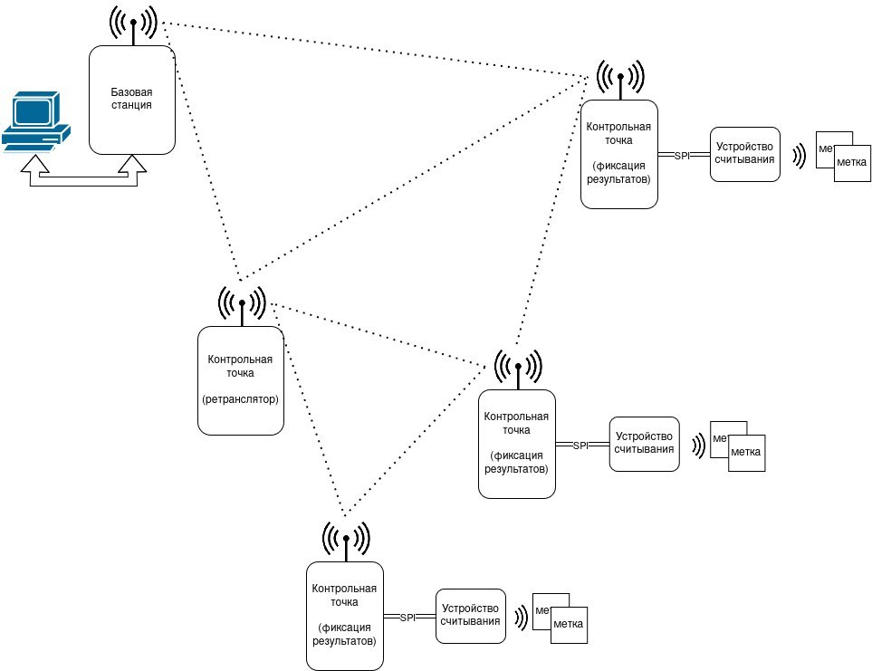

# Sportmesh

## Описание проекта
Cистема КП для спортивного ориентирования, трейлов с возможностью мониторинга участников соревнований в реальном времени на основе кастомной mesh-сети



## Прошивка

Прошивка использует `Arduino`-фреймворк а преимущества лежащего под ней
фреймворка `esp-idf` (например задачи, очереди и семафоры из `FreeRTOS`)

### Зависимости

| Библиотека | Версия |
| --- | --- |
| [LoRaMesher][loramesher] | `1.0.0` |
| [RadioLib][radiolib] | `7.8.1` |
| [MFRC522][mfrc522] | `1.4.12` |
| [TM16xx LEDs and Buttons][tm16xx] | `0.7.2512` |

[loramesher]: https://github.com/LoRaMesher/LoRaMesher
[radiolib]: https://github.com/jgromes/RadioLib
[mfrc522]: https://github.com/miguelbalboa/rfid
[tm16xx]: https://github.com/maxint-rd/TM16xx

### Сборка

`debug`-конфигурация:
```shell
pio run -e debug
```

`release`-конфигурация:
```shell
pio run -e release
```

### Документация

Установите Doxygen и выполните:

```shell
doxygen Doxyfile
xdg-open docs/html/index.html
```
